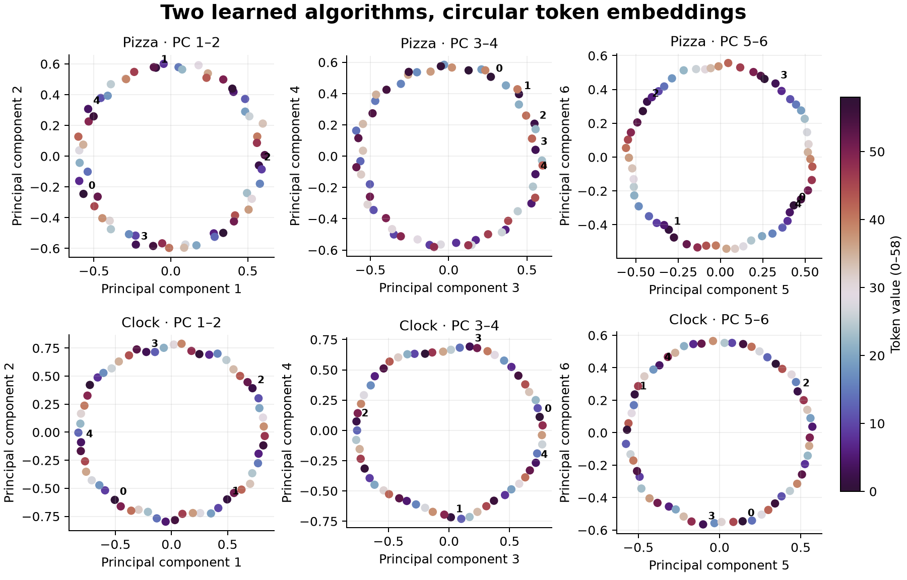

# Clock and Pizza: intervene on learned embedding circles

Two small transformers solve addition modulo 59 using different mechanisms.
Their token embeddings both contain circles. Isolating those circles reveals
how the models use them. This example reproduces **Table 2 and the distance
irrelevance diagnostic** from [Zhong et al., NeurIPS 2023, paper v2](https://arxiv.org/html/2306.17844v2),
using the authors' released Model A (Pizza) and Model B (Clock).

## Train a new model first

The [training example](../clock_and_pizza_training/README.md) now initializes this
same architecture from random weights, trains it with native Burn AdamW, and
inspects its learned activations. It records the split, learning curves, parameter
and optimizer records, and mechanism diagnostics. Use that workflow for fresh
training; the remainder of this guide preserves the released-checkpoint reference
and its original numerical claims.

## Run

Preparation requires NumPy, PyTorch, and safetensors in your Python environment.
It downloads two checkpoints and two configurations totaling **1,709,590 bytes**.
No training, tokenizer, dataset download, or GPU is needed.

```sh
python3 examples/mechanistic/clock_and_pizza/prepare.py
cargo run --release --locked --offline --example clock_and_pizza
```

Preparation writes verified weights, PCA coordinates, and independent reference
logits to ignored `target/mechanistic/clock_and_pizza/`. Each prepared safetensors
file is 4,975,164 bytes. Subsequent preparation can use `--offline`; `--refresh`
rebuilds derived files from verified sources. Rust performs no downloads.

Two Apple Silicon CPU executions took **1.80–1.92 seconds** and **220–237 MB peak
process RSS**, excluding compilation and preparation. Python packages are prerequisites;
their downloads and memory are not included in those figures. Other hosts will
differ. [result.json](result.json) records the measured run and its limits.

## Read and change the experiment

Start with [clock_and_pizza.rs](../../clock_and_pizza.rs). It loads a checkpoint,
captures token embeddings, projects them onto selected principal components,
and reruns the ordinary model through public `Hooks`.

The point `clock_pizza.token_embedding` has axes `[batch, token, channel]` and
occurs **before positional embeddings are added**. Its edit therefore changes
the token lookup table's contribution without changing positions. The component
ranges near the main loop reproduce fixed reference cases. To explore another
range, reuse the projection closure in a separate `Hooks` collection, outside
those fixed-reference assertions. The final attention-control closure is another
place to try a different rule without changing the published baseline.

[model.rs](model.rs) makes the actual graph visible: learned token and position
embeddings, one four-head attention block of width 128, a biased 512-neuron ReLU
MLP, both residual additions, and a linear vocabulary readout. There is no
normalization. Both models use **unmasked attention**:

```text
A = softmax(Q Kᵀ / sqrt(32))
A' = alpha * A + (1 - alpha) * J
```

`J` contains ones. Pizza uses `alpha=0`, so attention rows sum to **2**, not 1.
Clock uses `alpha=1`. The recipe calls shared `attend_with_pattern`; its structural
transform precedes user pattern captures and edits. Changing this rule in a
trained checkpoint is an intervention, not a reproduction of training under a
different rule.



Colors identify token values; labels mark tokens 0–4. PCA axis signs are arbitrary.
The picture shows geometry; the interventions establish its functional effect.

## Exact protocol and measurements

Evaluate every `(a,b)` in a-major order, all **3,481 pairs**, using the second
token's 59 logits. PCA centers the `[59,128]` embedding matrix. Isolation retains
components 1–2, 3–4, or 5–6 and reconstructs with the original mean restored.
The first-six intervention retains all three pairs.

| Embedding intervention | Pizza accuracy | Clock accuracy |
| --- | ---: | ---: |
| Unchanged | 100% | 100% |
| PCs 1–2 | 34.8176% | 13.5019% |
| PCs 3–4 | 32.8354% | 14.5361% |
| PCs 5–6 | 25.9983% | 4.3953% |
| PCs 1–6 | 99.6553% | 100% |
| Random plane, matched retained energy | 2.1546% | 1.6949% |
| Remove PCs 1–2 | 49.0664% | 19.4197% |
| Restore captured clean embeddings | 100% | 100% |

For Pizza's three circles, Table 2 compares all **205,379 output logits** against
the paper's Clock and Pizza formulas, with frequencies `17, 3, 44`. Each tensor
is independently standardized to mean zero and population variance one. FVE is
`1 - variance(standardized_model - standardized_formula)`, **not squared
correlation**. No predictor is fitted.

| Circle | Clock FVE: observed / paper | Pizza FVE: observed / paper |
| --- | ---: | ---: |
| 1 | 75.4079% / 75.41% | 99.1789% / 99.18% |
| 2 | 75.6161% / 75.62% | 99.1772% / 99.18% |
| 3 | 75.3767% / 75.38% | 99.2780% / 99.28% |

Distance irrelevance `q` uses only the correct-label logits. It divides average
within-input-difference population standard deviation by global standard
deviation. Pizza gives **0.171736**; Clock gives **0.848260**, matching the paper's
rounded **0.17 / 0.85**. Lower values indicate stronger dependence on input
separation. Individual isolated circles accentuate this difference.

## Controls and claim limits

Both baseline and all four PCA cases match independent PyTorch reference logits
over the complete grid: maximum absolute error **3.81e-5**. Capturing leaves
outputs unchanged; restoring captured embeddings recovers every logit exactly.
The unrelated plane uses seed 1729 and matches the first circle's retained
embedding energy. These controls are additional experiments, not published
aggregate results.

Normalizing Pizza's `J` leaves accuracy at 100%, but changes logits by up to
**25.0103** and moves `q` to **0.210257**. Accuracy alone would miss this incorrect
implementation of the published graph.

The following discrepancies remain explicit:

- Section 3.3 reports 32.8% for one isolated circle. Our **second** circle gives
  32.8354%; the first gives 34.8176%. The prose does not identify that circle.
- Section 3.3 reports **91.4%** for the first six components. The released model
  gives **99.6553%**, agreeing with the paper's later **99.7%** statement. Dropping
  the PCA mean, using uncentered SVD, and computing PCA in F64 do not explain
  91.4%. Its source remains unresolved; this example does not reproduce it.
- Notebook cell 21 evaluates an alternative Pizza expression and prints
  98.31/98.31/98.41%. This example uses the **paper's** expression for Table 2.

The predeclared tolerances are 0.02 percentage points for Table 2 and 0.01 for
the rounded `q` targets. Reference logits allow `0.002 + 0.00002 * abs(reference)`;
predictions must agree and reference `q` must differ by less than 2e-5. Accuracy
discrepancies are reported rather than changing the checkpoint or thresholds.

## Provenance and optional plot generation

[manifest.json](manifest.json) pins author commit
`4c7f2f31d215a51522b33f3ae2ef35f9c254ef6f`, all source hashes, shapes, and protocol.
The [author notebook](https://github.com/fjzzq2002/pizza/blob/4c7f2f31d215a51522b33f3ae2ef35f9c254ef6f/code/eval-main.ipynb)
identifies Pizza run `p99zdpze5l` and Clock run `l8k1hzciux`. Their training seeds
and split membership are not published. Evaluation uses the complete input grid.

Preparation uses restricted `torch.load(weights_only=True)` after verifying
pinned hashes; it never evaluates the configuration's lambda or imports remote
Python. Converted files are checked against the generated reference metadata.
Corrupted artifacts fail explicitly. Checkpoint weights remain in ignored storage.

To regenerate the figure with Matplotlib installed:

```sh
python3 examples/mechanistic/clock_and_pizza/plot.py
```

The script also writes an [editable SVG](embedding_circles.svg).
