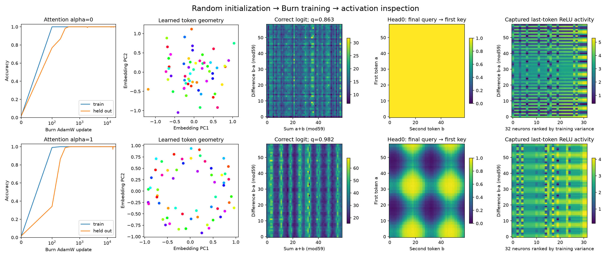
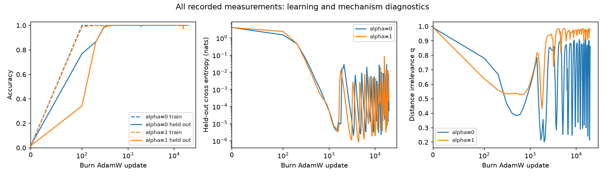

# Clock and Pizza: train, then inspect

Train the paper's one-block transformer from random weights using Burn's ordinary
`AdamW`, `GradientsParams`, `Autodiff`, and module records. Then capture the learned
embedding geometry, attention maps, and individual ReLU neuron activity through
public `Hooks`. Nothing downloads a checkpoint or dataset.

Start with [clock_and_pizza_train.rs](../../clock_and_pizza_train.rs). The complete
training loop is visible there. [model.rs](../clock_and_pizza/model.rs) is the same
registered, backend-generic model used by the historical checkpoint experiment.
Changing `alpha` changes the actual attention calculation during learning:

```text
attention = alpha * softmax(Q Kᵀ / sqrt(32)) + (1 - alpha) * J
```

Both conditions are bidirectional. Every entry of `J` is **one**. Thus `alpha=0`
sums values; it does not average them. The configured attention coefficient does
not guarantee a particular learned algorithm.

## Run

A small CPU smoke run checks that the training path executes. Its five updates
on 32 examples are **not** evidence of learning modular addition.

```sh
cargo run --release --locked --offline --features autodiff \
  --example clock_and_pizza_train -- --smoke \
  --output target/mechanistic/clock_and_pizza_training/smoke
```

Run the paper's 20,000-update budget for either attention condition on Apple
Silicon. Replace `--alpha 0` and the output suffix with `1` for learned attention.
Other platforms can use `--backend flex` and omit the `metal` feature.

```sh
cargo run --release --locked --offline --features autodiff,metal \
  --example clock_and_pizza_train -- --paper --backend metal --alpha 0 \
  --output target/mechanistic/clock_and_pizza_training/alpha0-paper
```

`--steps N`, `--seed N`, and `--evaluate-every N` make the compute budget explicit.
Without `--paper`, the default is a bounded 2,000 updates. A run refuses an existing
output directory containing a protocol, so repeated trials do not erase evidence.

With NumPy and Matplotlib installed, compare the two trained models:

```sh
python3 examples/mechanistic/clock_and_pizza_training/analyze.py \
  target/mechanistic/clock_and_pizza_training/alpha0-paper \
  target/mechanistic/clock_and_pizza_training/alpha1-paper
```

The analysis checks artifact hashes and independently recomputes the paper's
correct-logit distance irrelevance `q`. It also measures centered embedding PCA
and the paper's circularity statistic. `gradient_symmetry.json` records Definition
4.1 on 100 fixed input/output triples (sampling seed `20260911`). The plot uses the fixed first attention
head and ranks neurons by **training** activation variance.

## Measured results

Both fixed-seed runs completed all **20,000 updates** and reached **100% training
and held-out accuracy**. Alpha 0 took **253.16 seconds** and alpha 1 took
**231.91 seconds** on the local Apple Silicon Metal backend, excluding compilation.
Maximum process RSS was 151.7 MB and 145.9 MB respectively; the complete platform
memory measurements are retained in [results/](results/).

| Final diagnostic | Alpha 0: constant attention | Alpha 1: learned attention |
| --- | ---: | ---: |
| Held-out cross entropy, nats | 0.00005822 | 0.00037844 |
| Distance irrelevance `q` | 0.862948 | 0.982462 |
| Input-gradient symmetricity | 0.993119 | 0.242468 |
| Circularity of first four PCs | 0.439215 | 0.923548 |
| Capture/no-op maximum logit error | 0 | 0 |
| Burn model-record reload maximum logit error | 0 | 0 |

**Neither run satisfies the paper's 0.995 circularity threshold.** The constant
attention run learns a noncircular solution; the learned-attention run has
recognizable Fourier pairs but also falls below that criterion. These runs
establish successful training and contrasting gradient behavior; they do **not**
reproduce the representative circular Pizza/Clock mechanisms or their Table 2
values. No seeds were retried or removed after inspecting the outcomes.



Embedding colors identify token values. The attention plot fixes head 0, and
neuron selection uses training activation variance. Both executions use identical
compiled sources, the same executable, the same split, and the same initial
embedding hash, recorded in [result.json](result.json).



The full curves preserve temporary accuracy dips, confident-loss spikes, and
large changes in `q`. Training loss precision differs from the author code as
specified below; the curves make no assumption about the cause of each fluctuation.
The [evidence directory](results/) also preserves the failed engineering smoke
that revealed Burn's leaf-gradient identity requirement, followed by the passing
final regression tests. No failed scientific run was replaced.

## Training protocol

The recipe follows [Appendix F.1](https://arxiv.org/html/2306.17844v2#A6.SS1)
and the [pinned author training code](https://github.com/fjzzq2002/pizza/blob/4c7f2f31d215a51522b33f3ae2ef35f9c254ef6f/code/train-main.py):

- Addition modulo 59; all 3,481 ordered pairs; 2,784 training and 697 held out.
- One block, width 128, four 32-channel heads, biased 512-neuron ReLU MLP,
  learned token/position embeddings, two residual additions, no normalization.
- AdamW: learning rate 0.001, betas `(0.9, 0.98)`, epsilon `1e-8`, weight decay 2;
  ten-update linear warmup with the first update's learning rate zero.
- Author Gaussian initialization scales; zero MLP biases; seed `20260910`.
- Full training batch every update; no early stopping or seed selection.

Exact split memberships, source hashes, options, and the initial embedding hash
are saved **before** updates in `protocol.json`. `learning_curve.json` records
training/held-out cross entropy and accuracy, plus complete-grid `q` at every
measurement. The final `model.bin` and `optimizer.bin` use native full-precision
Burn records. They contain parameters and AdamW state; the protocol supplies the
architecture, split, and completed update count needed for a continuation.
A model-record reload must reproduce the final logits exactly.

## Add an intermediate loss or inspect a derivative

`Hooks::capture_with_grad` keeps activations connected to the registered model
parameters, so their tensors can contribute an auxiliary loss before ordinary
`backward()`. The Rust test demonstrates this using the ReLU activation tensor.

For the paper's gradient symmetricity diagnostic, we instead ask for a derivative
with respect to the token activations themselves. An edit callback explicitly
creates `tokens.detach().require_grad()` and retains that exact leaf tensor for
Burn's `grad()` lookup. This deliberate boundary belongs only to the diagnostic;
training retains the full graph. The callback is visible in
[study.rs](study.rs); it requires no model-specific backward hook machinery.

## What is and is not reproduced

This is fresh training under the published architecture and optimizer schedule.
The authors did not publish the representative runs' seeds or split memberships;
our seeded initialization and split are an explicit new realization. Burn's RNG
also differs from PyTorch's. Training uses the crate's differentiable, pairwise
F32 cross entropy; the author code casts logits to F64. Evaluation cross entropy
is accumulated in host F64.

A single run per condition cannot reproduce the paper's population phase diagram.
Every attempted condition remains visible, including models whose geometry does
not satisfy the paper's circularity threshold of 0.995. We report `q` and
circularity rather than infer a Clock or Pizza mechanism from `alpha` alone.
The [historical checkpoint analysis](../clock_and_pizza/README.md) separately
reproduces the specific released models' Table 2 values; it remains useful as a
numerical reference and is not presented as a training reproduction.
