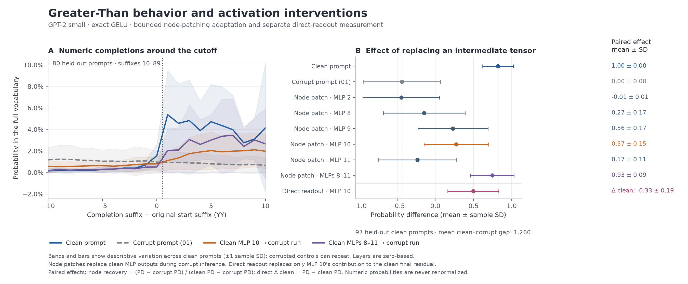

# Greater-Than: change a computation, then measure its effect

Which GPT-2 computations make an ending year larger than its starting year?
This bounded study follows Hanna et al.'s
[Greater-Than paper, version 5](https://arxiv.org/html/2305.00586v5), using fixed
year-span prompts and released weights. Read the ordinary consumer code in
[`examples/greater_than.rs`](../../greater_than.rs): capture a clean activation,
select an MLP output, replace that tensor during a corrupted forward pass, and
measure the changed distribution.

The main experiment is **node patching**, an adaptation of the paper's broader
path-patching analysis. A separately labeled measurement changes only an MLP's
direct contribution to the final readout. Neither demonstrates the complete
published circuit.

## Measured result

The [first passing Rust record](result.json) contains every condition and prompt.
On 97 held-out clean prompts, the clean-to-corrupt probability-difference gap was
**1.2601 ± 0.4517** (mean ± sample SD); no recovery denominator was negligible.
Patching all four late MLPs recovered **93.3% ± 9.1%** of that gap per prompt.
The preselected layer-2 comparison slightly worsened the corrupted prediction.

| Condition | Probability difference, mean ± SD | Cutoff sharpness | Mean node recovery |
| --- | ---: | ---: | ---: |
| Clean | 0.8206 ± 0.2026 | 0.0563 | — |
| Corrupt | −0.4395 ± 0.5055 | −0.0012 | — |
| Node patch, layer 2 | −0.4468 ± 0.5016 | −0.0012 | −0.8% |
| Node patch, layer 8 | −0.1481 ± 0.5356 | 0.0024 | 27.1% |
| Node patch, layer 9 | 0.2297 ± 0.4587 | 0.0105 | 55.8% |
| Node patch, layer 10 | 0.2719 ± 0.4209 | 0.0037 | 57.1% |
| Node patch, layer 11 | −0.2351 ± 0.5143 | 0.0002 | 17.3% |
| All four late nodes | 0.7445 ± 0.2863 | 0.0204 | 93.3% |

Joint patching restores most of the probability-difference gap but leaves a less
sharp cutoff than the clean run. Metrics can move differently: zeroing layer 10
reduces probability difference to 0.5853 while increasing sharpness to 0.1142.
The separate layer-10 direct-path intervention gives 0.4949 probability difference,
a **−0.3257** signed change from clean. This smaller fixture does not match the
paper's quoted direct-effect magnitude, and the node and direct measurements
should not be conflated. All reverse, zero, identity, and restoration results
remain in the JSON, including per-prompt variation.



The 8,148 Rust/reference row comparisons passed their frozen thresholds.
Maximum errors were `0.00061035` for vocabulary logits, `0.00009993` for
probability difference, `0.00007960` for sharpness, and `0.00007899` for numeric
probabilities. The 3,575,808 captured MLP elements had maximum error `0.00064087`.
All twelve observation/identity/restoration controls and clean-residual readout
were exact. Final-layer direct and reverse-node logits differed by at most
`0.00009155`, within the predeclared oracle tolerance.

## Prepare and run locally

Prepare the pinned [GPT-2 checkpoint and tokenizer](https://huggingface.co/openai-community/gpt2/tree/607a30d783dfa663caf39e06633721c8d4cfcd7e)
in a local directory containing `model.safetensors`, `config.json`, and
`tokenizer.json`. The model file is 548,105,171 bytes. Preparation checks all
three SHA-256 hashes and verifies every prompt's tokenization; it does not
download anything or execute a model.

An isolated Python environment can use the tested reference dependencies:

```sh
python3 -m venv target/greater-than-python
source target/greater-than-python/bin/activate
python3 -m pip install torch==2.10.0 transformers==5.2.0 numpy==2.4.3 \
  safetensors==0.7.0 tokenizers==0.22.2 huggingface_hub==1.4.1 matplotlib==3.11.1
```

Download exactly the three pinned artifacts into ignored local storage. This is
the explicit network step; the following preparation still verifies their hashes.
The arguments below match the locally checked Hugging Face Hub 1.4.1 API.

```sh
python3 - <<'PY'
from huggingface_hub import snapshot_download
snapshot_download(
    "openai-community/gpt2",
    revision="607a30d783dfa663caf39e06633721c8d4cfcd7e",
    allow_patterns=["model.safetensors", "config.json", "tokenizer.json"],
    local_dir="models/gpt2",
)
PY
```

```sh
python3 examples/mechanistic/greater_than/prepare.py --checkpoint models/gpt2
python3 examples/mechanistic/greater_than/reference.py
cargo run --release --locked --example greater_than
```

The independent reference uses PyTorch 2.10.0, Transformers 5.2.0, NumPy 2.4.3,
SafeTensors 0.7.0, and Tokenizers 0.22.2. Both implementations run the unchanged
weights in F32, with eager causal attention, evaluation mode, batch size 8, and
no cache or training. Reference preparation uses one CPU thread. Its oracle is
99,933,264 bytes; full per-condition reference measurements occupy about 26 MB.
Weights and generated oracles remain in ignored `target/mechanistic/greater_than`.
The initial Rust analysis took **196.21 seconds** on this CPU host; the independent
PyTorch reference took **31.70 seconds**. These exclude compilation and checkpoint
download. Peak RSS was unavailable in the initial sandboxed timing attempt;
parameter size alone is not a measured memory budget.

Use another prepared directory with `prepare.py --output DIRECTORY`,
`reference.py --directory DIRECTORY`, and `greater_than DIRECTORY`. The Rust
executable writes `DIRECTORY/result.json`; it verifies artifact and script
fingerprints before executing. A failed numerical gate returns an error after
preserving its raw result.
Add Cargo's `--offline` flag when dependencies are already cached; the recorded
validation used it. Rust experiment execution itself accesses local artifacts only.

## What is selected and changed

Every prompt has thirteen tokens, beginning with an explicit `<|endoftext|>`:

```text
clean:   <|endoftext|> The war lasted from the year 1732 to the year 17
corrupt: <|endoftext|> The war lasted from the year 1701 to the year 17
```

Only position 8 changes; position 12 predicts the completion. The selected
`Layer::decoder(L).mlp_output().token(12)` has shape `[batch, 1, 768]`. It includes
the MLP's output projection and bias, immediately before residual addition.
Layers are zero-based: 8–11 are the last four; layer 2 is a preselected comparison.

| Condition | Destination and intervention |
| --- | --- |
| Clean / corrupt | Matched ordinary inputs |
| Node patch | Corrupt forward receives the paired clean MLP output |
| Reverse | Clean forward receives the paired corrupt output |
| Zero | Clean forward receives zero at the selected node |
| Identity | Clean forward receives its own saved output |
| Restore | Zero the node, then restore its clean output in callback order |
| All late nodes | Replace layers 8, 9, 10, and 11 in one corrupt forward |
| Direct path | Read out `clean_final - clean_MLP + corrupt_MLP` |

The direct-path calculation keeps downstream components at their clean values,
then applies final LayerNorm and tied vocabulary projection normally. The node
patch reruns downstream computation. Zero ablation is an added control that
also removes the constant MLP bias; it is not the paper's matched `01` corruption.

To change the experiment, edit the obvious `NODE_LAYERS`, `LATE_LAYERS`, or
`.token(READOUT)` selections in the main file. The combined-late condition shows
how to register several replacements in the same execution. Changing a selection
requires a corresponding protocol/reference update; the pinned oracle is not a
universal acceptance test for different experiments.

## Fixture, graph, and measurements

The frozen [manifest](manifest.json) predates the study's model outputs. The
[fixture](fixture.json) has 97 development and 97 held-out clean prompts, one per
suffix `02`–`98`, chosen by SHA-256 from eligible years and the released noun list.
Clean prompts are disjoint across splits. Corruption collapses suffixes: there
are 92 distinct development and 88 distinct held-out corrupt strings, with ten
shared across splits. These are **held-out clean prompts with shared corrupted
controls**, not independent identically distributed samples.

Centuries 11–17 keep corruption aligned to one token. This deliberately restricts
the author's larger code pool: century 10 can change two token identities under
natural `01` corruption. The original scripts did not publish the exact sampled
10,000-prompt dataset or fix its random seed. See the
[source and tokenization investigation](../../planned/greater_than_protocol.md).

The original author's circuit explicitly uses **exact GELU**, while the pinned
HF configuration uses `gelu_new`'s tanh approximation. The example explicitly
selects exact GELU. All 197 original parameter-array entries were verified
bitwise equal to the HF weights after documented layout conversions; the
[GPT-2 prerequisite evidence](../../../src/models/gpt2/README.md) preserves that
comparison and separate numerical checks. Original rust-circuit execution itself
has not been compared.

Analysis computes a stable F64 softmax over all **50,257 unchanged F32 logits**,
then selects the 100 unspaced numeric tokens. It never renormalizes that subset.
For the original clean suffix `YY`, including when evaluating corrupted outputs:

```text
probability difference = sum(p[YY+1..99]) - sum(p[00..YY])
cutoff sharpness        = p[YY+1] - p[YY-1]
clean-corrupt gap       = clean_difference - corrupt_difference
node recovery          = (patched_difference - corrupt_difference) / gap
```

Recovery is `null` when `abs(gap) <= 1e-6`. Direct-path rows instead report signed
probability-difference change from clean; this is not normalized recovery. The
paper's quoted direct contribution is an absolute probability-difference change,
not a percentage of our baseline. Reported SD describes per-prompt variation.

## Numerical checks and claim boundaries

Before observing this fixture's results, the manifest fixed absolute tolerances:
`0.005` for full-vocabulary logit oracles, `0.0003` for probability difference,
`0.0001` for sharpness and numeric probabilities, and `1e-6` for identity,
restoration, empty-hook, and capture-only logits. MLP captures use
`0.002 + 0.00002 * abs(reference)`. There is no fitted scientific effect-size gate.

Every condition and prompt is compared with the independent reference. Full
vocabulary logits are checked for ten preselected prompts per condition; all
MLP captures at the selected token are checked. Additional algebraic checks
compare clean-residual readout with clean logits, and the last layer's direct
path with its reverse node patch, under the frozen logit tolerance. The reference
also cross-checks F64 analysis against independent NumPy/math calculations.

```sh
cargo test --release --locked --example greater_than
python3 -m unittest discover -s examples/mechanistic/greater_than -p 'test_*.py' -v
python3 examples/mechanistic/greater_than/plot.py
```

Plotting requires NumPy and Matplotlib. The plot refuses failed or mismatched
results. Its cutoff-aligned curves use the same 80 preselected held-out clean
prompts (suffixes 10–89) at every offset; the condition table uses all 97.
Error bars show descriptive sample SD, not confidence intervals. Use
`--result DIRECTORY/result.json --output-dir DIRECTORY` to plot another run.
The [plot validation record](plot_validation.json) records dependency versions,
artifact hashes, and visual checks of both PNG and independently rendered SVG.

The paper's 81.7% mean probability difference, 6.0% sharpness, and full circuit
results are published context, not pass thresholds for this reduced fixture.
No training, quantized GPT-2 support, or complete circuit reproduction is claimed.

The checked-in result is the immutable first passing run. A later reporter-only
change adds every crate-source hash, dependency-lock hashes, the executable hash,
and a source-stability check. The [final independent replay](../../../acceptance/measurements/v0_2-interface-validation-20260910-retry/replayed_results/greater_than.json)
passes the same frozen thresholds: maximum logit error `0.00039673`,
probability-difference error `0.00003714`, and exact within-run identity,
observation, and restoration controls. Small floating-point differences from
the first run remain visible in the separate records.

The [final validation manifest](../../../acceptance/measurements/v0_2-interface-validation-20260910-retry/manifest.json)
records 195.69 seconds and **874,725,376 bytes peak process RSS** for this replay,
measured by macOS `/usr/bin/time -l`. All 29 validation steps passed with the
complete input inventory unchanged. The [earlier consolidated attempt](../../../acceptance/measurements/v0_2-interface-validation-20260910/post_run_audit.json)
passed its numerical checks but was rejected when a plot-validation report was
added during execution. That attempt and the original study remain preserved;
the successful retry does not overwrite or relabel either observation.
