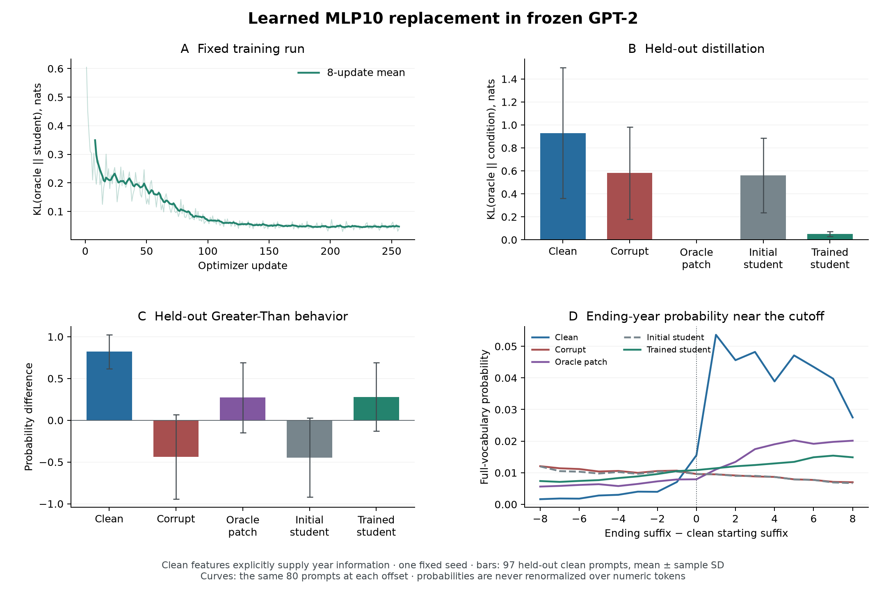

# Learn a replacement inside a frozen transformer

This example trains a 49,952-parameter bottleneck to replace one GPT-2 MLP output.
Read [`greater_than_train.rs`](../../greater_than_train.rs) for the consumer code:
an ordinary Burn `Module`, a public activation callback, a KL loss, and Adam.
Gradients pass through GPT-2's remaining block and readout while every backbone
parameter stays frozen.

This is a **new conditioned distillation experiment**, extending the
[Greater-Than node-patching study](../greater_than/README.md). The student receives
features from the **clean** prompt, which explicitly supply the removed year
information. It learns to imitate the clean-output patch inside a **corrupted**
forward. This is not the original paper's training, full GPT-2 retraining, or a
claim that the student recovers information absent from its inputs.

## Measured endpoint

The [first fixed-run result](result.json) contains every prompt, condition, and
training loss. On the 97 held-out clean prompts, mean oracle-to-student KL fell
from **0.5622 to 0.0500 nats**, a 91.1% reduction. Development KL fell from 0.5341
to 0.0467 nats. These are measurements from one fixed seed and this bounded
fixture; there was no validation-based model or hyperparameter selection.

| Held-out condition | Oracle KL, mean ± SD | Probability difference, mean ± SD | Cutoff sharpness | Mean gap recovery |
| --- | ---: | ---: | ---: | ---: |
| Clean | 0.9293 ± 0.5697 | 0.8206 ± 0.2026 | 0.0563 | 100% |
| Corrupt | 0.5810 ± 0.4022 | −0.4395 ± 0.5055 | −0.0012 | 0% |
| Original clean-output patch | 0.0000 ± 0.0000 | 0.2719 ± 0.4209 | 0.0037 | 57.1% |
| Initial student | 0.5622 ± 0.3241 | −0.4461 ± 0.4718 | −0.0019 | −3.4% |
| Trained student | 0.0500 ± 0.0206 | 0.2796 ± 0.4095 | 0.0013 | 57.4% |

The learned replacement approaches its teacher's probability difference and
recovery, but its cutoff is less sharp. Neither replacement reproduces the full
clean computation. Probability difference slightly above the teacher does not
imply a better reconstruction: the full-vocabulary KL remains nonzero.



The run verified unchanged backbone bytes, a finite nonzero student weight
gradient through the frozen later block, changed student parameters, and exact
next-step equality after student/Adam record reload. The 49,952 trainable
parameters took 98.88 seconds for training and 136.52 seconds for loading,
preparation, training, and evaluation on this CPU host, excluding compilation.
This records the cost of this run, not a throughput or hardware qualification.

The [execution evidence](../../../acceptance/measurements/v0_3-greater-than-20260910/README.md)
retains the exact executed source, command, output logs, binary hash, and
parameter-record hashes. Plot the frozen result with NumPy and Matplotlib:

```sh
python3 examples/mechanistic/greater_than_training/plot.py
```

The plot uses all 97 held-out prompts for condition summaries and the same 80
prompts with starting suffixes 10–89 at every cutoff-relative offset. Error bars
show sample SD. The [plot validation record](plot_validation.json) records
versions and figure/data hashes. The recorded `result.json` and figures exist
only in the Git repository, so in the published crate the default `--result` is
missing: run the full study below, then pass `--result
target/mechanistic/greater_than_training/full/result.json --output-dir
target/mechanistic/greater_than_training/full`.

## Run it

First prepare the pinned local GPT-2 artifacts using the
[existing preparation instructions](../greater_than/README.md#prepare-and-run-locally).
The training executable verifies the checkpoint and fixture hashes itself; it
does not download weights or require generating the original reference outputs.
Then run from the repository root:

```sh
# Eight development prompts, two updates, no held-out evaluation.
cargo run --release --locked --offline --features autodiff \
  --example greater_than_train -- --smoke

# The fixed 256-update study, including endpoint held-out evaluation.
cargo run --release --locked --offline --features autodiff \
  --example greater_than_train
```

Default outputs are `target/mechanistic/greater_than_training/smoke` and `full`.
Existing output directories are rejected so earlier measurements remain intact.
For another run, pass `--output-dir NEW_DIRECTORY`; use
`--prepared-dir DIRECTORY` for another copy of the same authenticated artifacts.
The example uses Flex F32 on CPU and native Burn autodiff and Adam.

## What the student replaces

The original fixture pairs a clean year-span prompt with one whose starting
suffix is changed to `01`. It has 97 development and 97 held-out clean prompts;
clean prompts are disjoint, but ten corrupted control strings are shared across
splits. Token 12 predicts the ending-year suffix. Layer numbers are zero-based.

1. Run each development clean prompt once and capture layer 10's `mlp_input`
   and `mlp_output` at token 12, both `[batch, 1, 768]`.
2. Patch the captured clean output into its corrupted prompt. Cache that
   ordinary forward's 50,257 teacher logits.
3. Map the clean input through `Linear(768, 32) → tanh → Linear(32, 768)`.
4. Replace `Layer::decoder(10).mlp_output().token(12)` with the student's output
   in an ordinary corrupted forward. The residual addition, frozen block 11,
   final normalization, and tied vocabulary projection execute normally.
5. Minimize full-vocabulary `KL(teacher || student)` with Adam.

The callback is the key interface:

```rust
hooks.edit(Layer::decoder(10).mlp_output().token(12), |_| {
    self.student.forward(clean_features.clone())
});
```

`Experiment` owns both the backbone and student as registered Burn submodules.
Calling `backbone.train::<Autodiff<Cpu>>().no_grad()` freezes its parameters while
retaining derivatives with respect to the replacement tensor. Converting the
whole computation to an inference backend during training would break that path.
Default captures detach these fixed clean features and teacher targets.

## Fixed protocol and checks

The [protocol](protocol.json) was saved before training: seed `20260910`, 256
updates, batch size 8, learning rate `0.003`, Adam with per-parameter tensor gradient-norm clipping at
1.0, and a fixed SHA-256 permutation of development indices. There is no early
stopping or search. Both the saved initial student and the trained endpoint are
evaluated on held-out clean prompts only after training finishes. The graph uses
the original study's exact GELU and unchanged pretrained F32 parameters.

The executable checks a finite, nonzero student gradient through the later
frozen computation; only its four weight/bias tensors receive parameter
gradients. It hashes every backbone parameter byte before and after training.
At update 128 it writes native Burn student and Adam records, reloads them, and
requires the next update to equal uninterrupted optimization exactly before
continuing. These engineering checks do not assert a scientific effect size.

Output files include `result.json`, the frozen protocol, midpoint/final student
records, and midpoint/final Adam records. The result records every prompt and
condition, training losses, parameter hashes, executable/source hashes, and
record hashes. Reload records with the same architecture and frozen backbone;
the unchanged pretrained weights are referenced rather than serialized again.

## Measurement meaning

Evaluation compares clean, corrupted, original clean-output patch (oracle),
initial student, and trained student. The primary distillation metric is
full-vocabulary KL to the oracle. The task metrics match the original study:
probability difference between ending suffixes above and at/below the clean
starting suffix, cutoff sharpness, and total probability on numeric tokens.
A stable F64 softmax uses all 50,257 unchanged F32 logits before selecting the
100 numeric tokens; that subset is never renormalized.

Gap recovery is `(condition PD - corrupt PD) / (clean PD - corrupt PD)` per
prompt, or null when the denominator's magnitude is at most `1e-6`. Reported
standard deviations describe variation across these fixed prompts. The oracle
itself patches only MLP10 and therefore need not reproduce the clean model.
