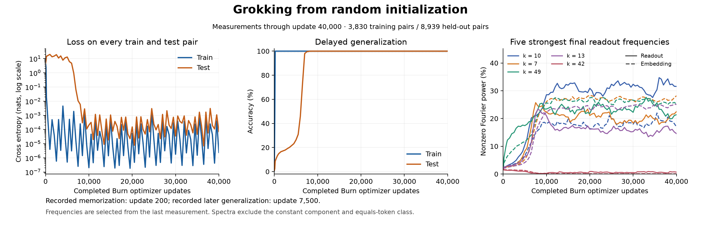

# Train, then interpret grokking

This example trains the paper's modular-addition transformer **from random
initialization**, records its delayed generalization, then examines the Fourier
circuit it learned. It uses this crate's transformer attention and activation
hooks with Burn's ordinary `Autodiff`, `Module`, AdamW, and record APIs.

## Start with the training step

Read [grokking_train.rs](../../grokking_train.rs): the model computes logits,
Burn computes cross entropy and gradients, and AdamW returns the updated model.
There is no separate trainer framework. The backend-generic
[GrokkingTransformer](../grokking_model.rs) owns every learned tensor as a
registered parameter. Its `forward_with_hooks` also supports connected activation
captures and interventions during training.

The [study helper](study.rs) handles the fixed dataset, evaluation, and records;
[analyze.rs](analyze.rs) contains the final capture/keep/remove/restore experiment.
The same architecture still supports the independent
[archived-checkpoint Table 1 analysis](../grokking.md).

## Run locally

A short CPU compatibility check needs no downloads:

```sh
cargo run --release --locked --offline --features autodiff --example grokking_train -- --steps 10 --output target/mechanistic/grokking-smoke
```

The complete, preregistered run uses 40,000 full-batch updates:

```sh
cargo run --release --locked --offline --features autodiff,metal --example grokking_train -- --backend metal --output target/mechanistic/grokking-training-metal-seed0
```

Omit `metal` and `--backend metal` to use Flex on a CPU. `--benchmark --steps 10`
measures the chosen backend with an extra synchronized forward per update;
it does not establish grokking. The fixed protocol is intentionally a real
training experiment, so the ten-step smoke cannot replace the complete run.

Outputs stay beneath `target/`. `progress.json` records both complete splits and
Fourier power. `initial-model.bin` and every `checkpoint-XXXXX/` contain Burn
records; each checkpoint includes the optimizer's moments and counters.
`latest.json` is updated only after both records are written. Resume an
interrupted run with the same seed, backend, and output directory:

```sh
cargo run --release --locked --offline --features autodiff,metal --example grokking_train -- --backend metal --resume --output target/mechanistic/grokking-training-metal-seed0
python3 examples/mechanistic/grokking_training/plot.py target/mechanistic/grokking-training-metal-seed0/progress.json --output target/mechanistic/grokking-training-metal-seed0/training.png
```

Plotting needs Matplotlib. Training does not use Python, PyTorch, a pretrained
checkpoint, or a downloaded dataset. The 3,830 training indices are committed;
the disjoint 8,939-pair complement is used only for evaluation.

## What establishes reproduction

The [frozen protocol](protocol.md) and [manifest](manifest.json) precede the run.
The criterion requires a recorded point with training accuracy above 99% and
held-out accuracy below 50%, followed by a later held-out accuracy above 99%.
There is no outcome-dependent early stopping. The report retains unsuccessful
runs and reports transitions only at the measurement resolution.

Training includes all 114 classes, including `=`; the subsequent Fourier analysis
uses the 113 numeric classes. The learned five strongest frequency pairs are
selected from this run's readout, then patched through public hooks. They are
not copied from the author's checkpoint. Capture-only and remove/restore
controls must preserve logits within `1e-6` and `1e-3`, respectively.

This is a bounded reproduction of the learning phenomenon and its learned
mechanism. Burn initialization and F32 differentiable loss differ from the
original notebook's initialization stream and F64 loss. It does not claim the
original seeded trajectory, the paper's multi-seed aggregate, or identical
Table 1 frequencies.

## Observed result

The complete [recorded run](result.json) took **394.84 seconds** on a local Apple
Silicon Metal backend, including initialization, records, and interpretation.
Peak resident memory was 141.8 MB; the process's peak memory footprint was
527.7 MB. These are measurements from this host, not portable performance claims.

| Optimizer updates | Training accuracy | Held-out accuracy |
| ---: | ---: | ---: |
| 0 | 0.60% | 0.97% |
| 200 | 100% | 8.59% |
| 7,000 | 100% | 97.94% |
| 7,500 | 100% | 99.56% |
| 40,000 | 100% | 100% |

Training first exceeded 99% within `(100, 200]` updates; held-out accuracy first
exceeded 99% within `(7000, 7500]`. The model therefore memorized the training
set well before learning the general modular-addition rule. All 40,000 updates
ran; the successful intermediate result did not stop training.



The fixed five-pair selection found frequencies `[10, 7, 49, 13, 42]`. Keeping
that ten-dimensional MLP subspace preserved **100% accuracy** over all 12,769
pairs; removing it reduced accuracy to **9.6014%**; restoring it recovered 100%.
Capture-only logits were identical and restoration's maximum logit error was
`3.05e-5`. The four dominant pairs account for 89.96% of nonconstant readout
Fourier power; the fifth, 42, is weak. This fresh run differs from the archived
model's five strong frequency pairs.

The inherited zero-intercept sinusoid diagnostic produced some negative values
because fresh activations have nonzero means. Its original output is preserved
in [raw evidence](evidence/learned-circuit.json). A separately labeled affine
fit removes the constant offset: the four dominant pairs explain 78.37–96.83%
of their projected activation variation; frequency 42 has negligible fit.
This diagnostic was added after training and is not a reproduction of Table 1.
An independent centered least-squares fixture verifies its definition.

## Inspect a saved run

A read-only replay can use Flex even when training used Metal:

```sh
cargo run --release --locked --offline --features autodiff --example grokking_train -- --analyze --output target/mechanistic/grokking-training-metal-seed0
```

It loads the learned Burn record and writes `learned-circuit-replay.json` without
updating parameters, optimizer state, progress, or the original report. Metal
and Flex replays gave identical accuracies; their maximum cross-entropy difference
was `3.21e-9`. See [validation.json](validation.json).

Scientific training resumes require the same backend, seed, data split, frozen
protocol, and training-source fingerprints. Earlier step targets and benchmark
resumption are rejected. The [executed-source archive](evidence/executed-source.tar.gz)
preserves the successful run before these resume guards and the affine diagnostic
were added. Its original binary, source hashes, raw curves, and legacy analysis
remain distinct from the final-source replay.

## Check the example

```sh
cargo test --release --locked --offline --features autodiff --example grokking_train
python3 -m unittest discover -s examples/mechanistic/grokking_training -p 'test_*.py' -v
```

Rust tests verify all eleven parameter tensors receive gradients, a connected
activation loss participates in optimization, Burn model/optimizer records
resume the next update exactly, and invalid resumes fail clearly. Python tests
independently verify the author split, protocol, frequency convention, and
corrected affine-fit mathematics.
