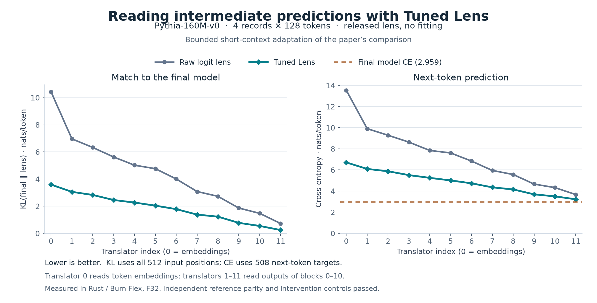

# Read intermediate predictions with a Tuned Lens

Capture Pythia's residual activations, pass them through the authors' small
learned translators, and compare their predictions with a raw logit lens and
the complete model. Start with the editable [Rust recipe](../../tuned_lens.rs);
artifact loading and reporting live separately in [study.rs](study.rs).

This is a **short-context bounded adaptation** of the comparison in Figure 5 of
[Tuned Lens, paper v4](https://arxiv.org/abs/2303.08112v4). It tests whether the
released translators improve intermediate predictions on a fixed small fixture.
It does not train either the model or the lens.

## Run on a CPU

From the repository root, with the repository's Rust toolchain and Python 3.11:

```sh
python3 -m pip install torch==2.10.0 safetensors==0.7.0 tokenizers==0.22.2 numpy==2.4.3
python3 examples/mechanistic/tuned_lens/prepare.py
python3 examples/mechanistic/tuned_lens/reference.py
cargo run --release --locked --features tokenizers --example tuned_lens
```

The optional experiment downloads about **781 MB** once; prepared artifacts and
reference outputs occupy about **1.50 GB**, excluding dependency/build caches.
Everything stays under ignored `target/mechanistic/tuned_lens/`. Reuse verified
downloads with `prepare.py --offline`. No GPU or training run is required.

Preparation checks hashes, loads PyTorch weights with `weights_only=True`, and
exports local SafeTensors. The independent F32 reference follows
[Hugging Face 4.28.1's equations](https://github.com/huggingface/transformers/blob/v4.28.1/src/transformers/models/gpt_neox/modeling_gpt_neox.py).
Its metric calculations use F64 on those F32 logits; Rust uses pairwise F32
vocabulary sums and F64 aggregation across tokens.
The Rust run writes `rust_result.json` and a readable `predictions.html` table.
Run the protocol checks with:

```sh
python3 -m unittest discover -s examples/mechanistic/tuned_lens -p '*_tests.py' -v
cargo test --release --locked --features tokenizers --example tuned_lens
```

## Observed result

The released translators improve both metrics at all twelve boundaries in this
fixture. Final-model CE is **2.958839 nats/token**. Maximum reference errors are
**0.000356 logits** and **0.00000737 nats/token**; observation and zero-correction
controls both have zero logit error. A measured Flex/F32 CPU run took **25.53 s**
with **1.27 GB** peak RSS, including artifact validation but excluding downloads
and compilation. An independent second Rust replay also passed. These local
measurements are not a portable performance benchmark.

| Captured boundary | KL: raw → tuned | CE: raw → tuned |
| --- | ---: | ---: |
| Embeddings | 10.434356 → 3.590396 | 13.540502 → 6.710545 |
| After block 5 | 4.004639 → 1.781289 | 6.836727 → 4.732756 |
| After block 10 | 0.725376 → 0.241242 | 3.666401 → 3.221506 |



The [recorded measurements](result.json) include exact metrics and provenance.
To redraw the figure after a successful run, install Matplotlib and run
`python3 examples/mechanistic/tuned_lens/plot.py`. The per-token prediction table
is generated automatically as `target/mechanistic/tuned_lens/predictions.html`.

## What is held fixed

[manifest.json](manifest.json) pins every URL, byte count, and SHA-256:

| Artifact | Exact revision |
| --- | --- |
| `EleutherAI/pythia-160m-deduped-v0`, historical model and tokenizer | `7e57cc978f5da949f028f36b5baf8f5d6c3281b1` |
| Same model's later SafeTensors export | `26b9eeef106f66faf9b45930f92430a8a77c8799` |
| `AlignmentResearch/tuned-lens` Space, released lens | `1ac7285852a22309f571c2555efc37375d0c4cda` |

Preparation proves all **184 tensors** match between the historical and later
model files by name, dtype, shape, and raw bytes. It exports **148 learned
tensors** to F32 and records the **36 excluded derived buffers** in
`tensor_equivalence.json`. Causal masks and F32 rotary frequencies are rebuilt
from configuration, matching the historical reference's initialized cache.
All 24 released lens tensors are retained.

A pinned 65,536-byte range of Pile `test.jsonl` contains 25 complete records,
preserved locally. The fixture uses the **first four**, independently tokenized
without automatic special tokens. Prepend EOS ID 0 once per record, then keep
the first 128 tokens including EOS. This produces **512 KL positions and 508
next-token targets**; selection never depends on model outcomes.

## Activations and measurements

| Translator | Captured input |
| --- | --- |
| 0 | `Stack::Decoder.embedding()` |
| `i` = 1–11 | `Layer::decoder(i - 1).residual_post()` |

These are the embedding state and residuals after blocks 0–10, corresponding to
`hidden_states[:-1]`. Block 11 contributes to the complete-model baseline.
For each captured `h`, the raw lens applies the pretrained final LayerNorm and
vocabulary projection. The tuned lens first applies **`h + Linear_i(h)`**:
the saved translator is a correction to identity.
[Author implementation](https://github.com/AlignmentResearch/tuned-lens/blob/65f3135ad1e849e2e5b0f7c5adbd857c787bfb64/tuned_lens/nn/lenses.py#L306-L315)

Lower is better for both token-weighted metrics, reported in **nats/token**:

- **KL(final || lens):** agreement with the complete model, at all input positions.
- **Cross-entropy:** prediction at position `t` against input token `t+1`, excluding
  each record's last prediction.

Before measuring Rust, parity limits were fixed at **0.005 maximum absolute
logit error** and **0.0002 absolute metric error**, with no relative tolerance.
Logit parity covers all 50,304 vocabulary entries at the first eight positions
of the first record; metric parity covers the entire fixture and all translators.

## Numerical accuracy

Initial runs exposed two long-vocabulary reduction errors: Flex's sequential
F32 sum biased KL by about 0.00113, and the original PyTorch F32 metric oracle
itself differed from independent F64 calculations by about 0.000272. Both
NumPy and PyTorch F64 agreed to 1.3e-14 on the same logits. The analysis helpers
were corrected; the model, released translators, fixture, full-logit oracle,
and acceptance limits stayed fixed. Regression tests cover an analytically
known distribution with a long probability tail. [result.json](result.json)
preserves the original reference, failed measurements, and diagnosis.
Replay the independent diagnosis with
`python3 examples/mechanistic/tuned_lens/diagnose_reductions.py`; it does not
modify the primary reference or experiment results.

## Change the experiment

In the Rust recipe, `Hooks::capture` selects the states and `hooks.get` retrieves
ordinary device tensors. `project_hidden` supplies the pretrained readout.
Change `REPLACE_TRANSLATOR` to inspect another boundary, or replace its ordinary
`Linear` module with your own transformation. The included zero-correction
replacement must recover the raw lens; observing activations must preserve
ordinary forward logits. Keep those controls when experimenting.

The paper evaluates 16.4 million tokens in 2,048-token chunks and reports bits
per byte. This four-record experiment reproduces the comparison method and
examines its direction, not the published numerical curve or a population-wide
claim. It uses the original released lens, not newer paper revisions' retrained
lenses. Fixture changes require regenerated preparation and reference outputs;
report resulting differences rather than adjusting tolerances after measurement.
