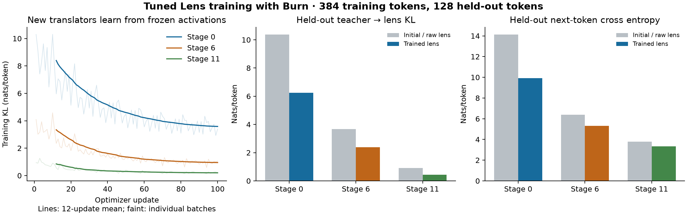

# Train a Tuned Lens with Burn

[`tuned_lens_train.rs`](../../tuned_lens_train.rs) learns new affine translators
from zero corrections to the identity. The pretrained Pythia backbone supplies
intermediate activations and teacher predictions; the authors' released lens
weights are never loaded. The existing [`tuned_lens`](../tuned_lens/README.md)
experiment remains an independent reference for their released translators.

## Run the experiment

The preparation command verifies the same pinned Pythia-160M artifacts used by
the inference example. It needs Python with PyTorch, SafeTensors, and tokenizers;
its initial downloads total approximately 781 MB. Existing prepared artifacts
can be reused without downloading anything.

```sh
python3 examples/mechanistic/tuned_lens/prepare.py --offline
cargo run --release --locked --offline --features autodiff,tokenizers \
  --example tuned_lens_train
python3 examples/mechanistic/tuned_lens_training/reference.py
python3 examples/mechanistic/tuned_lens_training/plot.py  # optional: matplotlib
```

Omit `--offline` on the preparation command when downloading for the first time.
Generated caches, translator and optimizer records, and measurements go into
`target/mechanistic/tuned_lens_training/`. The Rust example accepts an optional
prepared backbone directory followed by an output directory.

## What the consumer writes

The main example shows the entire training loop. A registered `Lens` owns three
ordinary Burn modules: an affine correction, the frozen final LayerNorm, and the
frozen vocabulary projection. Its forward pass is simply:

```rust
let translated = hidden.clone() + self.translator.forward(hidden);
self.unembedding.forward(self.final_norm.forward(translated))
```

`Hooks::capture` selects raw residual states from the pretrained transformer.
These detached activations can be cached because the backbone is frozen.
The new translator uses `Autodiff<Flex>`; its logits go through
`training::kl_divergence(student_logits, teacher_logits)`, `backward`, and Burn's
ordinary `GradientsParams` and SGD optimizer. Freezing the decoder's parameters
preserves the gradient path from its output back into the translator.

There is no bespoke trainer. The small companion helper verifies local artifacts,
clips the two affine gradients with one global coefficient, and records controls.
Burn's built-in per-tensor norm clipping would apply a different coefficient to
each parameter, so the example makes this distinction explicit.

## Fixed training protocol

The [manifest](manifest.json) was written before training outcomes were observed.
The experiment trains three independent translators at stages 0, 6, and 11.
Stage 0 means the embedding output; stage `i > 0` means the residual after block
`i - 1`, before its next block or any final normalization.

Training uses records 4–15 from the pinned Pile prefix; validation uses records
16–19. Each document receives an initial EOS token and is truncated independently
to 32 tokens. The split has 384 training tokens and 128 held-out tokens. It has no
shared documents, no concatenation across documents, and no padding. The earlier
released-lens evaluation used records 0–3, which this training run does not use.

Each translator receives 100 SGD updates, cycling through the 12 training records.
The learning rate starts at 0.02 and decays linearly. Nesterov momentum is 0.9,
dampening is zero, weight decay is 0.001, and the global gradient norm is clipped
at 1. Each translator starts as `h + Linear(h)` with zero weight and bias.

The objective is the token-mean `KL(teacher || student)` over all 50,304 vocabulary
entries. Shared differentiable pairwise reductions stabilize the F32 loss.
Reported held-out KL and next-token cross entropy use F64 reductions on the
unchanged F32 logits; next-token CE excludes each document's final position.
Validation is measured only before and after the fixed run. It selects neither a
checkpoint nor an early stopping time. The acceptance criterion is lower final
held-out KL at each selected stage; next-token CE is reported independently.

## Checks and interpretation

The run verifies that zero corrections exactly reproduce the raw logit lens,
both translator parameters participate in autodiff with a finite, nonzero
combined gradient, and every frozen
backbone and decoder parameter remains bitwise unchanged. Halfway through each
run it saves the translator and SGD momentum using Burn recorders, reconstructs
the trainable module, reloads both records, and compares the next optimizer update
with an uninterrupted control. Training then continues from the loaded state.

`reference.py` independently reconstructs each first training batch in PyTorch.
It checks the full-vocabulary KL, both clipped affine gradients, and both parameter
tensors after the first Nesterov update against tolerances fixed in the manifest.
It does not access validation inputs or choose hyperparameters.

## Measured learning result

The first fixed run improved both held-out metrics at every selected stage.
An unchanged replay reproduced every training loss and held-out metric exactly.
Each translator has 590,592 learned parameters; all 300 optimizer updates
completed with finite gradients. Identity and resumed-update errors were zero,
and both whole-backbone and frozen-decoder parameter hashes stayed unchanged.

| Stage | Initial KL | Trained KL | Initial next-token CE | Trained next-token CE |
| --- | ---: | ---: | ---: | ---: |
| 0: embedding | 10.367084 | 6.238877 | 14.121468 | 9.907981 |
| 6: after block 5 | 3.664828 | 2.383964 | 6.383902 | 5.318786 |
| 11: after block 10 | 0.916634 | 0.436519 | 3.774799 | 3.340742 |

Values are nats per token. The independent PyTorch check passed for all three
first updates: maximum loss error was `7.49e-7`, clipped-gradient error `6.15e-5`,
and updated-parameter error `2.34e-6`, within the preregistered tolerances.
The [result record](result.json) preserves provenance, curves, numerical controls,
and measured runtime. The recorded native replay took 62.27 seconds and peaked
at 1.67 GB resident memory. The [measurement record](measurement.json) and
[replay history](replay_history.json) retain execution details;
[measure.py](measure.py) repeats the native run with
resource accounting and an inventory of the source files present during execution.



This is a bounded reproduction of the learning method in
[Belrose et al., section 3](https://arxiv.org/html/2303.08112v4#S3). The original
study trained all layers for 250 updates with 262,144 tokens per update, used
2048-token concatenated contexts and a base learning rate of 1.0, and evaluated
16.4 million tokens. This small experiment tests whether newly trained
translators improve held-out predictions and integrate cleanly with Burn; it
does not reproduce the original quantitative benchmark or pretrain Pythia.
